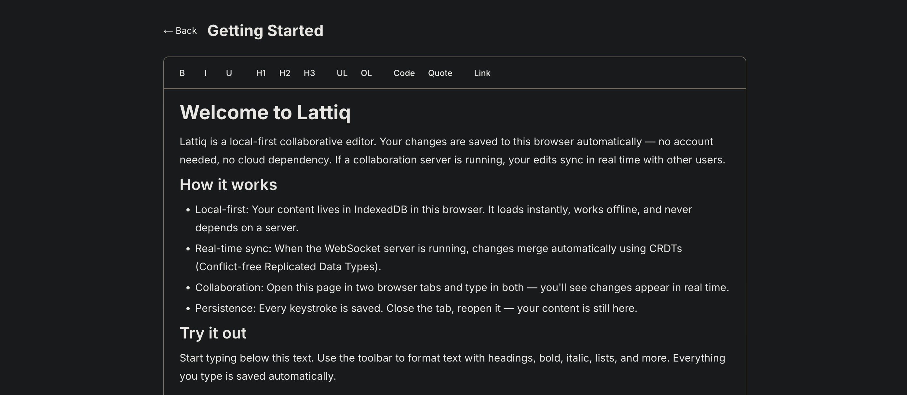

# Lattiq

A local-first collaborative rich text editor built with Next.js, Lexical and Yjs.



## What it does

Lattiq is a rich text editor where the document lives in the browser first. Changes are saved to IndexedDB as you type, with no account. When the room server is reachable, edits sync in real time between clients using Yjs CRDTs (Conflict-free Replicated Data Types), and edits made offline merge when the connection returns.

## Features

- **Local-first persistence**: every edit is a Yjs operation stored in IndexedDB. Documents open from this device, work offline and survive reloads with no server.
- **Real-time collaboration**: a small WebSocket room server relays Yjs updates. Concurrent and offline edits merge without conflicts.
- **Presence**: other people's carets, selections and names, an active-users list and a sync status indicator.
- **Rich text editing**: headings, bold, italic, underline, lists, code blocks, quotes and links, with Yjs-aware undo.
- **Real documents**: the welcome page and three public domain books ship as pre-built Yjs seeds, up to Pride and Prejudice (127K words).

## Measured

Production build, two headless Chrome contexts on localhost (Apple M3). Full method and every run in [docs/live-sync-report.md](docs/live-sync-report.md); raw output in [bench/results.json](bench/results.json).

| | median |
|---|---|
| Open Pride and Prejudice (2,509 blocks) from IndexedDB, server down | 213 ms |
| Open it on a first visit (seed over HTTP, then sync) | 269 ms |
| Keystroke in one client to the character in another | 1.4 ms |
| Offline edits from two clients merged, after both reconnect | 21 ms |

## Tech stack

- **Framework**: Next.js 15 (App Router)
- **Editor**: Lexical with `@lexical/yjs` (CollaborationPlugin)
- **CRDTs**: Yjs, y-indexeddb, y-protocols
- **Sync**: custom provider and room server (`ws`), signed room tokens, file persistence
- **Tests**: Playwright
- **Language**: TypeScript

## Architecture

```
Browser                                    Room server (Node, long-lived)
┌──────────────────────────────┐          ┌───────────────────────────┐
│ Lexical + CollaborationPlugin │          │ rooms: Y.Doc + awareness  │
│              │                │          │            │              │
│            Y.Doc ─────────────┼── WS ───►│ relay, sync step 1/2      │
│        │          │           │  token   │            │              │
│   IndexedDB   seed (HTTP,     │          │ .lattiq-data/doc-*.yjs    │
│               applied once)   │          │ (new rooms start from the │
└──────────────────────────────┘          │  same seed)               │
                                           └───────────────────────────┘
```

1. On open, the provider loads the document from IndexedDB and, the first time, applies its seed. Only then does it go online.
2. Each edit is applied to the Y.Doc, written to IndexedDB and sent to the room server, which relays it.
3. On (re)connect, both sides swap state vectors and send only what the other lacks. That is how offline edits merge, even across reloads.

Seeds are generated by headless Lexical through its own Yjs binding with a fixed client ID, so the browser and the server can both apply one without duplicating content.

## Getting started

```bash
pnpm install
pnpm dev      # Next.js on :3000
pnpm dev:ws   # room server on :3001
```

Open [http://localhost:3000](http://localhost:3000) and open the same document in two windows. Without the room server, documents still work and save locally.

### Scripts

| Script | What it does |
|---|---|
| `pnpm seed [docId]` | Regenerate `public/seed/*.yjs` (downloads Gutenberg texts once into `.lattiq-cache/`) |
| `pnpm test:e2e` | Production build, then Playwright: two-client sync, offline merge, seeds, access control, hydration |
| `pnpm bench` | Same build, then the benchmarks; writes `bench/results.json` |

### Environment

| Variable | Where | Purpose |
|---|---|---|
| `NEXT_PUBLIC_WS_URL` | Next.js, **build time** | Room server URL, e.g. `wss://sync.example.com`. Unset in production means local-only. |
| `LATTIQ_ROOM_SECRET` | Next.js and room server | Signs and checks room tokens. Unset means the room server is open (local dev). |
| `ALLOWED_ORIGINS` | room server | Comma-separated origins allowed to connect |
| `PORT` | room server | Default 3001 |
| `LATTIQ_DATA_DIR` | room server | Where rooms persist; put it on a persistent volume |
| `LATTIQ_SEED_DIR` | room server | Default `public/seed` |

## Project structure

```
src/
  app/
    doc/[id]/                   # Document page (editor renders client-side)
    api/collab-token/           # Signs a short-lived token for one room
  components/editor/
    CollaborativeEditor.tsx     # Lexical + CollaborationPlugin + presence
    ActiveUsers.tsx, SyncStatus.tsx, CursorsContainer.tsx
    ToolbarPlugin.tsx
  hooks/useCollaboration.ts     # Opens a document session for the editor
  lib/
    yjs/collaboration-provider.ts  # WebSocket provider: sync, awareness, backoff, heartbeat
    yjs/doc-session.ts             # Y.Doc + IndexedDB + seed + provider + identity
    room-token.ts                  # HMAC room tokens and room-name rule
    seed/                          # Gutenberg client, text parser, seeded doc list
    initial-content.ts             # Welcome page content (built into a seed)
server/index.ts                 # Room server
scripts/build-seeds.ts          # Seed generator (headless Lexical)
public/seed/                    # Generated seeds, committed
e2e/                            # Playwright tests and benchmarks
```

## Learning project

This codebase is thoroughly commented as a reference for understanding:
- How Lexical's plugin architecture works
- How Yjs CRDTs represent document state
- How the Yjs sync protocol exchanges updates between peers
- How local-first architecture prioritises offline capability
- How WebSocket rooms manage per-document collaboration

## Licence

MIT
